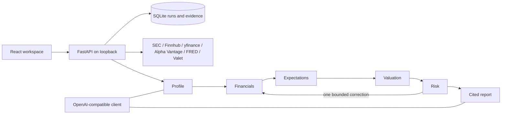

# StockScope AI

Local, educational U.S. stock research with partial Canadian coverage with six specialist roles, evidence-linked calculations and a persistent execution trace. React/Vite + FastAPI + SQLite; no accounts or paid services required in explicit fixture mode.



The backend validates each stage independently and persists every attempt, failure, retry and handoff. All numeric claims bind to captured evidence or deterministic calculations. Missing consensus or evidence keeps a run `incomplete`, even when all six stages finish. The heatmap is a separate official TradingView visual and never feeds data to agents.

## Run locally

Requires Node 22+, npm, Python 3.11+. Tested on WSL2 with Node 22.23.3/Python 3.13.11. Keep both servers bound to loopback. In the project root:

```bash
cd backend
python3 -m venv .venv
source .venv/bin/activate
python -m pip install -r requirements.lock
python -m pip install -e '.[dev]'
uvicorn app.main:app --reload --host 127.0.0.1 --port 8000
```

In a second terminal:

```bash
cd frontend
npm ci --legacy-peer-deps
npm run dev -- --host 127.0.0.1
```

Open http://127.0.0.1:5173. API contracts: http://127.0.0.1:8000/docs. Vite proxies `/api` to the backend. The Python lock records tested versions; npm's lockfile pins the frontend graph. The legacy-peer-deps option avoids an observed npm 10 optional-peer resolver error while using a patched Vitest version compatible with Vite 6.

Default `DATA_MODE=fixtures` uses clearly labeled **invented synthetic** AAPL/MSFT/NVDA and ETF inputs and a deterministic model stub. These are test data, not historical financial facts, live quotes or real AI analysis. It needs no keys. The third-party heatmap still uses its own external data and may fail when blocked; search and research continue to work.

Features: market ETF proxies/heatmap; stock search and sourced annual facts; simple positions and unrealized P&L; watchlists; six-stage research; stock-context chat; stored reports, inputs, validation attempts/events and Markdown download; limited daily review/news with explicit headline-only AI summaries when a live model is configured; three optional FRED indicators and two no-key Bank of Canada indicators; 20 guided industry topics. Representative-company runs use the same pipeline. All unsupported coverage is labeled.

## Configure live data and AI

Optionally create a root `.env` from `.env.example`. Credentials remain server-side; no frontend `VITE_` keys. This project never reads personal Codex or other projects' LiteLLM configuration.

| Variable | Purpose |
|---|---|
| DATA_MODE | fixtures (default) or live; no automatic fixture fallback |
| DATABASE_URL | SQLite path, default `sqlite:///./stockscope.db` relative to backend process working directory |
| LLM_BASE_URL | OpenAI-compatible `/v1` endpoint; loopback/link-local IPv4 HTTP or HTTPS |
| LLM_MODEL / LLM_API_KEY | Real model identifier / provider key (key can be empty for an authorized local server) |
| LLM_TIMEOUT / LLM_MAX_TOKENS | Bounded request timeout/output limit |
| SEC_USER_AGENT | Genuine descriptive identity and contact email for SEC access |
| FINNHUB_API_KEY | Authorized U.S. quotes and news; plan rights must be verified |
| HISTORY_PROVIDER | auto (default), yfinance or alpha_vantage; missing sources leave history unavailable |
| ALPHA_VANTAGE_API_KEY | Optional alternative U.S. compact daily history, at most 100 observations |
| FRED_API_KEY | Optional Treasury yield, federal funds rate and WTI series |
| BANK_OF_CANADA_ENABLED | true (default); no-key Canadian FX and policy-rate observations |

Optional no-key history support (from the project root):

```bash
backend/.venv/bin/python -m pip install -r backend/requirements-history.lock
backend/.venv/bin/python -m pip install -e 'backend[history]'
```

`HISTORY_PROVIDER=auto` tries installed yfinance, then optional Alpha Vantage for U.S. history. yfinance is an unofficial Yahoo wrapper for personal/educational research; its software licence does not grant data redistribution rights. Exact Canadian symbols such as `RY.TO` (TSX) and `.V` (TSXV) are accepted for optional daily history and CAD positions. Canadian identity/statements and Finnhub free current quotes remain unavailable; these gaps carry through research. SEDAR+ scraping is not implemented. Bank of Canada macro needs no key. Missing optional integrations never prevent startup.

Restart the backend after configuration changes. Settings lists missing variable names without revealing secrets. A local LiteLLM proxy is optional; WSL `127.0.0.1:4000` works only if the proxy is reachable in the same network namespace. Check your configured service without changing it. See [provider access and quotas](docs/DATA_PROVIDERS.md).

The existing Strata iq3_s connection has passed real inference and a tool-using validated profile stage. Actual yfinance AAPL/USD and RY.TO/CAD daily history and Bank of Canada FXUSDCAD/V39079 observations now pass live checks. SEC facts/identity/filings and Finnhub quotes now pass for AAPL/MSFT/NVDA; AAPL company news also passes (docs/LIVE_PROVIDER_ACCEPTANCE.json). Full sourced six-stage research remains pending: lossless history metadata packing fixes observed context overflow, but a previous run exhausted the total-token budget; the user-authorized 120-second timeout now permits a validated sourced profile; financials still hit output/total-token limits and no report was produced (docs/LIVE_SOURCED_RUN.json). No additional U.S. credentials are needed to continue model-integration work. No paid entitlement or model-quality advantage is claimed. SEC does not provide analyst consensus. There are no forecasts, target prices, trading actions or Canadian fundamentals. Annual EPS ratios are labeled annual, not TTM. SEC filing fiscal years are kept separate from fact period dates; unknown publication dates remain unavailable. Yahoo history explicitly uses auto_adjust=False Close and is not a total-return series; split handling is provider-specific. Alpha Vantage compact daily data has its own documented adjustment policy.

## Verify and demonstrate

```bash
cd backend
source .venv/bin/activate
pytest -q
ruff check .
python -m app.services.evaluation
```

```bash
cd frontend
npm run lint
npm run test
npm run build
npm audit
```

Verified: 117 backend tests and 18 frontend tests pass; production build and Ruff/TypeScript checks pass; the previous dependency audit reported 0 frontend vulnerabilities (not rerun for this backend provider revision). See [phase acceptance](docs/IMPLEMENTATION_STATUS.md), [actual checks and remaining work](docs/PROGRESS.md), [demo walkthrough](docs/DEMO.md), [baseline evaluation](docs/EVALUATION.md), [API](docs/API.md) and [architecture](docs/ARCHITECTURE.md). Evaluation currently measures deterministic fixture workflows on identical evidence; it establishes no live six-agent advantage. The [real browser smoke](docs/BROWSER_SMOKE.md) verifies navigation, mutations, six stages, restart persistence, mobile overflow and forced heatmap failure/retry with zero runtime errors. Screenshot perception remains unverified because vision-analyze lacks its NVIDIA key. An earlier restricted sandbox run hung in Starlette thread dispatch; the resumed ordinary checks passed without escalation.

SQLite schema v1 initializes additively; unknown future schema versions are rejected until explicitly migrated. Reports store immutable evidence snapshots. On restart, interrupted runs become incomplete and can be relaunched. This is local development software, not a public multiuser service. Research queue and model calls have bounded budgets; model/provider errors expose sanitized failures.

## References and scope

Vibe Research (MIT) inspired six-stage methodology; OpenStock (AGPL-3.0) supplied conceptual dashboard ideas only. No OpenStock code is copied. [Reference audit with pinned SHAs](docs/REFERENCE_AUDIT.md) records inspected paths; [industry acknowledgments](docs/INDUSTRIES.md) cover adapted topic concepts. The official TradingView widget retains attribution and separate terms. Source rights/plan permissions apply to live data.

The [roadmap](docs/ROADMAP.md) keeps Canadian current quotes/fundamentals, backtesting, full portfolio accounting, alerts and other Later features deferred. China-specific A-share trading sentiment is excluded. Read the authoritative implementation specification and progress file before resuming development.
